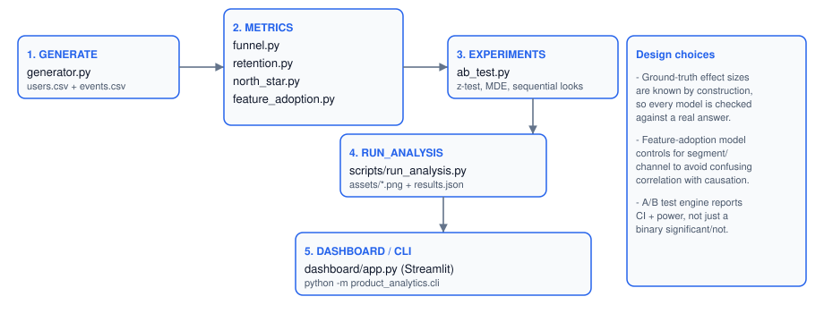
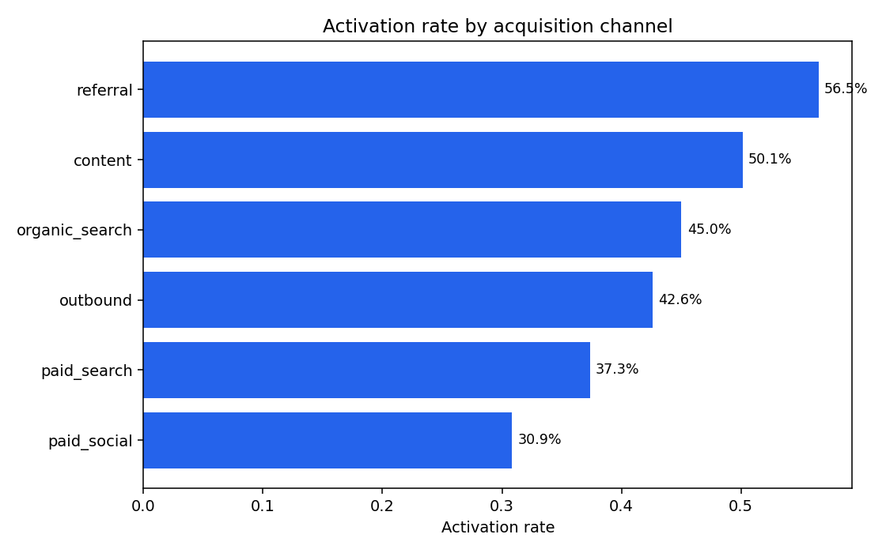
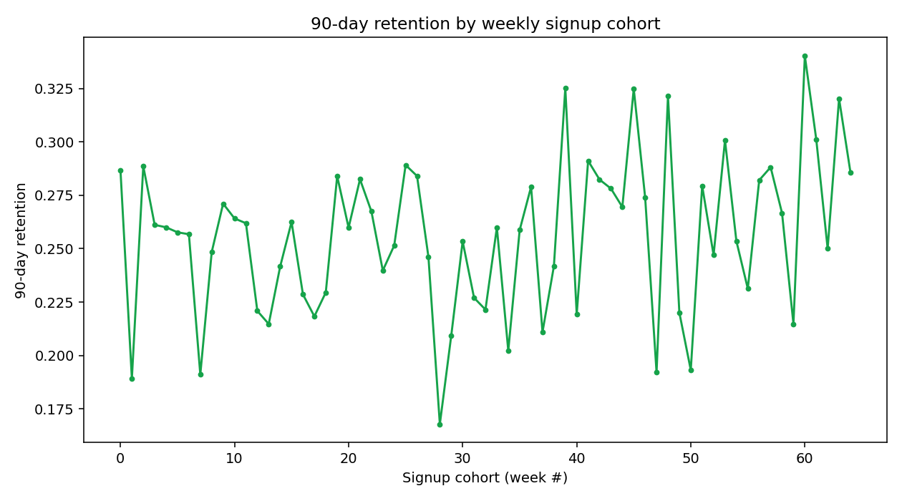
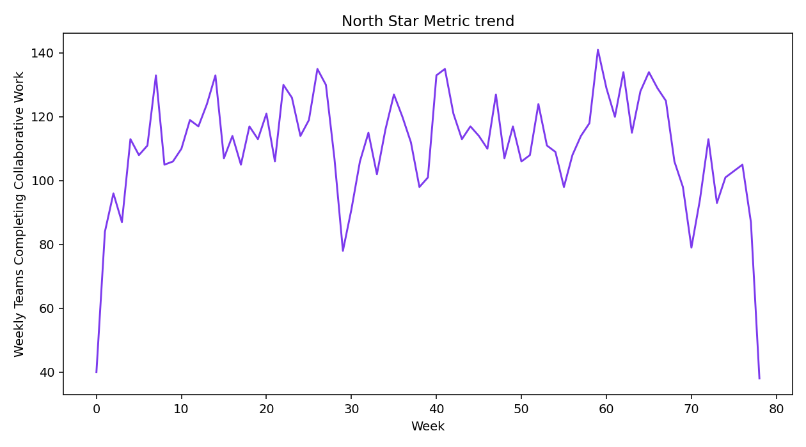
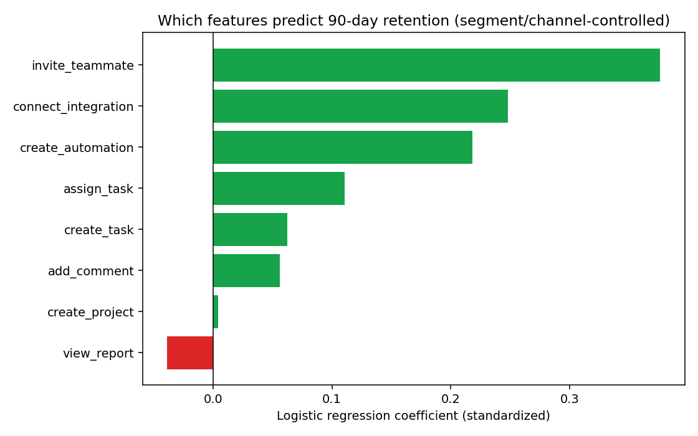
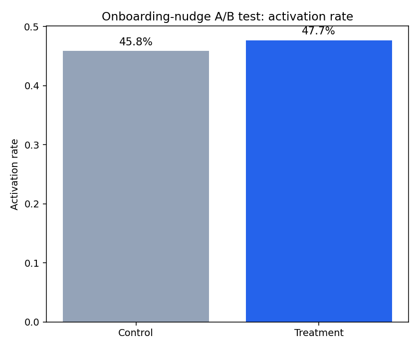

# Product Growth Analytics

A product-analytics workflow for a hypothetical B2B SaaS product ("Flowboard"):
activation funnel, cohort retention, a causal-aware feature-adoption model, a
North Star Metric, and a proper A/B-testing engine (z-test + confidence
interval + sample-size calculator + a demonstration of why uncorrected
repeated peeking inflates false positives). Every number below comes from
running the code in this repo against the synthetic dataset it generates --
nothing is hand-typed.

> **On the data:** fully synthetic, generated with deliberately-injected
> ground-truth effects so the analysis has something real to be checked
> against. See [`data/README.md`](data/README.md). No real product, company,
> or user data anywhere in this repository.

## Architecture



## Quickstart

```bash
python3 -m venv .venv && source .venv/bin/activate
pip install -r requirements.txt

python scripts/run_analysis.py        # regenerates every number/plot below, ~10s
streamlit run dashboard/app.py

python -m product_analytics.cli funnel
python -m product_analytics.cli ab-test
python -m product_analytics.cli sample-size --baseline-rate 0.3 --mde 0.02

python -m pytest tests/ -q             # 18 tests
```

## 1. Activation & conversion funnel

11,375 observable signups (window-truncated so every user has had 30 days to
convert):

| Metric | Value |
|---|---|
| Activation rate | **41.8%** |
| Trial -> paid conversion | **6.9%** |
| Activated -> paid | 16.5% |



Referral (56.5% activation, 19.1% activated->paid) and content (50.1%
activation) are the two strongest channels; paid_social is the weakest
(30.9% activation) despite being the second-largest channel by volume
(2,113 signups) -- a real budget-allocation flag, not a hypothetical one,
since the same pattern recurs in the feature-adoption and retention results
below. Full channel table in `data/generated/funnel_by_channel.csv`.

## 2. Retention



90-day retention across 10,070 matured-cohort users: **25.6%**. By segment,
`small_team` retains best (28.6%) and `solo` worst (23.0%) -- consistent with
a collaboration product whose value compounds with more teammates in it.

## 3. North Star Metric: Weekly Teams Completing Collaborative Work

**Why this metric and not WAU:** weekly active users counts *any* login,
including a user who opens the app and does nothing. The metric chosen here
only counts users who performed a collaboration-signaling action that week
(`invite_teammate`, `add_comment`, or `assign_task`) -- i.e. it's gated on
the behavior that's actually correlated with retention (see section 4), not
just presence in the product. The tradeoff: it's a smaller, noisier number
than WAU, and that's the point -- a North Star should be hard to move by
accident.



## 4. What actually predicts retention? (feature-adoption model)

L2-logistic regression of 90-day retention on feature usage, **controlling
for segment and channel** (so a feature's coefficient isn't just picking up
"bigger teams use more features and also retain better"):



| Rank | Feature | Standardized coefficient |
|---|---|---|
| 1 | `invite_teammate` | **+0.376** |
| 2 | `connect_integration` | +0.248 |
| 3 | `create_automation` | +0.218 |
| 4 | `assign_task` | +0.111 |
| 5 | `create_task` | +0.062 |
| 6 | `add_comment` | +0.056 |
| 7 | `create_project` | +0.004 |
| 8 | `view_report` | -0.038 |

Train accuracy 61.5% on 4,208 activated users -- reported honestly rather
than omitted; this is a single logistic model on 8 binary features plus
controls, not a metric to lead a slide with. **`invite_teammate` is the
single strongest predictor by a wide margin**, which is exactly the behavior
the North Star Metric above is built around -- the two analyses agree with
each other because they're both measuring the same underlying thing, not by
coincidence.

## 5. A/B test: onboarding teammate-invite nudge

Real result, including the part that doesn't look good on a slide:

| | Control | Treatment |
|---|---|---|
| n | 648 | 669 |
| Activation rate | 45.8% | 47.7% |



- Absolute lift: **+1.85pp** (95% CI: **-3.5pp to +7.2pp**)
- p-value: **0.501** -- **not statistically significant**
- The dataset's true injected effect is +4.5pp; the observed +1.85pp is
  noisy but consistent with it, since it falls inside the confidence
  interval. The honest conclusion from this test alone is *"we don't know,"*
  not *"it doesn't work."*

**Why it's inconclusive, quantified, not just asserted:**
`required_sample_size(baseline_rate=0.458, min_detectable_effect=0.02)`
returns **9,771 users per arm**. The test as run had 648-669 -- roughly
**15x under-powered** to reliably detect even a 2pp effect, let alone
distinguish it from the noise seen here. This is the single most common
real-world A/B testing mistake (stopping a test that ran too short, on too
few users, and reading the result as a null finding), and this project
computes the number that would have flagged it *before* running the test,
not just after.

### Why not to just peek until it looks significant

`sequential_boundary_check()` re-runs the same two-proportion test at 5
interim "looks" on the same growing dataset and compares uncorrected vs.
Bonferroni-corrected significance at each look (`data/generated/ab_test_sequential_looks.csv`).
This is the standard illustration of why checking a dashboard daily and
declaring victory the moment p < 0.05 appears is a real statistical error,
not a nitpick -- repeated uncorrected looks inflate the true false-positive
rate well above the nominal 5%.

## Repository layout

```
product_analytics/data/generator.py        synthetic Flowboard signup/activation/event data
product_analytics/metrics/funnel.py         activation + conversion funnel, by channel/segment
product_analytics/metrics/retention.py      weekly-cohort 90-day retention
product_analytics/metrics/north_star.py     North Star Metric definition + weekly trend
product_analytics/metrics/feature_adoption.py  segment/channel-controlled logistic retention model
product_analytics/experiments/ab_test.py    two-proportion z-test, CI, sample-size calc, sequential-look demo
product_analytics/cli.py                    funnel / ab-test / sample-size commands
scripts/run_analysis.py                     regenerates every number and plot in this README
dashboard/app.py                            Streamlit: funnel, retention, North Star, feature adoption, A/B test
tests/                                      18 tests: generator, metrics, experiment engine
assets/                                     architecture diagram, plots, results.json
data/                                       generated CSVs, data/README.md
```

## Limitations

- **Single-model feature analysis.** One L2-logistic regression is not a
  causal-inference pipeline (no instrumental variables, no matching) --
  segment/channel controls reduce but don't eliminate confounding.
- **The A/B test's headline result is genuinely a null result at this sample
  size** -- see above. That's reported as the actual finding, not
  papered over with a larger simulated sample chosen after the fact to make
  it "work."
- **North Star Metric is a single hand-chosen definition**, not compared
  against alternatives quantitatively (e.g. a formal metric-tree analysis
  scoring several candidate North Stars against downstream revenue
  correlation) -- a natural next step.
- **No multi-touch attribution** -- the funnel treats a user's channel as a
  single first-touch label, which is a real simplification for any user with
  more than one touchpoint before signup.

## License

MIT -- see [LICENSE](LICENSE).
